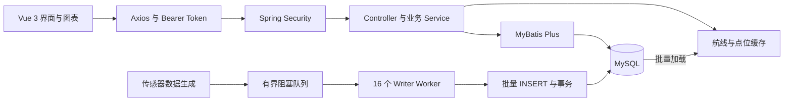

# NAUTIX

### 船舶运行监测与态势感知平台

NAUTIX 面向船舶运行监测，将船位、航线、传感器读数、海域天气与异常事件集中到一个平台，支持历史查询、统计分析和异常过程追溯。项目采用 Spring Boot + Vue 3 前后端分离架构，并内置数据仿真与中英双语界面。

[后端仓库](https://github.com/TongYan05/NAUTIX) · [前端仓库](https://github.com/TongYan05/Nautix-Front)

## 项目亮点

- **异步批量写入**：基于 Producer–Consumer 模型，用容量 **1,000,000** 的 `ArrayBlockingQueue` 连接数据生成与落库；**16 个 Writer Worker** 按单批最多 **50,000 条**写入，每批独立事务。
- **查询范围控制**：结合 `ID Range + Time Filter` 缩小候选数据范围，关闭分页自动 `COUNT`；单船统计先截取最近最多 **50,000 条**读数，再按传感器配置执行 `AVG / STDDEV_POP`。
- **航线集中缓存**：正常有数据时，通过 **2 次批量查询**加载航线与点位，排序分组后建立进程内缓存；总览抽稀并保留首尾点，详情按需返回完整航迹。
- **异常事件聚合**：支持 **5 种阈值比较运算**，按 `(ship_id, rule_id)` 复用活跃事件；持续越界更新数值峰值，恢复时记录结束时间和持续时长。
- **地图绘制预算**：静态图层与动态船位分离，初始化后的常规刷新只请求 **1 个船位接口**；使用 Inline SVG 绘制船标记，最多 **800 艘**，热力网格聚合后最多绘制 **160 个点**。

以上数字是当前代码中的容量、上限与查询次数，不代表压测吞吐或性能提升结论。

## 功能概览

| 模块 | 功能 |
| --- | --- |
| 监测大屏 | 船舶、传感器与告警概况，趋势图和分布统计 |
| 船舶管理 | 船舶资料维护、检索与运行状态查询 |
| 传感器中心 | 类型字典、船舶传感器配置、历史读数、趋势与波动统计 |
| 告警管理 | 阈值规则、告警记录、异常事件与处理状态 |
| 航线与港口 | 航线及点位查询、港口资料、航迹总览与详情 |
| 态势地图 | 船位、航线和相关地理图层，船流热力展示 |
| 海域天气 | 海域气象信息查询与展示 |
| 数据分析 | 船舶、传感器和告警等业务数据的图表分析 |
| 自然语言助手 | 规则路由的业务查询，以及日期、算术、单位换算等本地功能 |
| 认证与界面 | 注册登录、JWT 认证、登录失效处理、中英切换与操作日志 |

自然语言助手通过关键词和词边界匹配选择预置查询或本地工具，不调用外部 LLM。业务回答基于查询结果组织；“不依赖外部 LLM”不等于平台无需后端或数据库。

## 技术栈

| 层次 | 技术 |
| --- | --- |
| 后端 | Java 17、Spring Boot 3.5.16、Spring Security |
| 数据访问 | MyBatis-Plus 3.5.9、MySQL、MySQL Connector/J |
| 认证 | JWT / JJWT 0.12.6、无状态认证 |
| 数据仿真与导入 | Java 并发队列、独立写线程、DataFaker、EasyExcel、Apache POI |
| 前端 | Vue 3、TypeScript、Vite、Vue Router、Pinia |
| 界面与图表 | Element Plus、ECharts、SVG 地图图层 |
| 请求与构建 | Axios、Maven Wrapper、npm、vue-tsc |

具体依赖版本以两个仓库的 `pom.xml`、`package.json` 和锁文件为准。

## 系统架构



### 写入流程

生成器产生 `SensorDataMessage`，通过 `SensorDataQueue` 入队。队列满时 `put` 阻塞生产者，形成背压；消费者通过 `drainTo` 取出最多 50,000 条消息，调用独立的 `BatchWriter` 完成多值 `INSERT`。

队列用于进程内削峰。批次不足上限时也会写入，不需要等待凑满；数据库事务回滚不会自动把已取出的消息重新入队，当前队列也不提供跨进程持久化。

### 查询与缓存

- 时间查询同时保留真实时间过滤，并用生成速率估算主键下界，减少候选范围。该估算依赖 ID 与时间的相关性，回填、速率变化或久远时间窗需要注意完整性。
- 分页关闭自动计数，返回总量采用估算口径；当前页码分页仍不是游标分页。
- 单船波动统计的 50,000 条上限作用于这艘船的候选读数集合，再按配置分组，并非每种传感器各取 50,000 条。
- 航线缓存保存完整点位，总览与详情复用；缓存属于当前后端进程，数据变更后需要刷新。

### 认证与前端刷新

除 `/auth/**` 和 `/public/**` 外，接口要求认证。后端配置 401 / 403 JSON 响应，前端 Axios 拦截层收到这两类响应后清理本地会话并跳转登录页。当前配置以登录认证为主，不将其描述为完整的多租户或细粒度 RBAC 系统。

地图首次加载基础资料与位置数据，后续轮询主要更新动态船位。800 艘是单次绘制上限，160 个是聚合热力点上限，均不表示全部数据库对象同时显示，也不保证特定设备的帧率。

## 本地运行

### 1. 环境要求

- JDK 17。
- MySQL 8.x，以及已有的表结构和基础数据。
- Node.js **20.19+（20.x）或 22.12+**，满足当前前端锁文件的引擎要求。
- Git 与 npm；后端使用仓库自带的 Maven Wrapper。

### 2. 获取代码

```bash
# 后端
git clone --branch main https://github.com/TongYan05/NAUTIX.git shipsensor

# 前端
git clone --branch frontend https://github.com/TongYan05/Nautix-Front.git nautix-frontend
```

也可直接使用已有的 `shipsensor/` 和 `nautix-frontend/` 本地目录。

### 3. 准备数据库

```sql
CREATE DATABASE IF NOT EXISTS ship_sensor
  CHARACTER SET utf8mb4
  COLLATE utf8mb4_general_ci;
```

创建数据库后，导入匹配当前实体与 Mapper 的表结构及演示数据。主要表包括：

```text
user                   ship_info              ship_runtime_status
sensor_dict            sensor_config          sensor_data
route                  route_point            port
weather_region         alert_rule             alert_record
alert_event            sys_operation_log
```

**当前仓库没有提供独立的 `schema.sql` 或数据库迁移脚本，也不会自动创建以上表。** 数据初始化器和 `resources/data/ports.xlsx` 用于补充业务数据，不能替代建表。空库启动前需要先准备表结构；演示数据还应包含船舶、传感器字典与配置的有效关联。

### 4. 配置并启动后端

配置文件：`shipsensor/src/main/resources/application.yaml`。

| 配置项 | 用途 |
| --- | --- |
| `DB_URL` | 覆盖 JDBC 连接地址，默认连接本机 `ship_sensor` |
| `DB_USERNAME` | 数据库用户名 |
| `DB_PASSWORD` | 数据库密码 |
| `jwt.secret-key` | JWT 签名密钥，使用自行生成的至少 32 字节密钥字符串 |
| `jwt.expiration` | Token 有效期，当前配置为 86,400,000 毫秒 |
| `server.port` | 默认 `1910` |
| `server.servlet.context-path` | 默认 `/api` |

数据库三项已支持环境变量覆盖。JWT 密钥通过 `jwt.secret-key` 配置；若需要从环境变量读取，可将其值改为 `${NAUTIX_JWT_SECRET}` 并设置对应变量。

```bash
cd shipsensor
./mvnw spring-boot:run
```

Windows PowerShell 使用：

```powershell
cd shipsensor
.\mvnw.cmd spring-boot:run
```

服务地址：`http://localhost:1910/api`。

验证进程接口：

```bash
curl http://localhost:1910/api/public/ping
```

`/public/ping` 验证接口可达，不代表全部数据库与业务数据已经就绪。

### 5. 配置并启动前端

```bash
cd nautix-frontend
npm ci
npm run dev
```

访问 Vite 输出的本地地址，通常为 `http://localhost:5173`；端口占用时以终端实际输出为准。

当前 `src/api/axios.ts` 的 `baseURL` 直接配置为 `http://localhost:1910/api`。虽然 `.env.development` 声明了 `VITE_API_BASE_URL`，Axios 实例目前没有读取它；更换后端地址时需要同步修改请求实例，或将实例改为读取环境变量。

后端当前 CORS 配置允许本机 `localhost` 与 `127.0.0.1` 来源。通过其他域名访问时，应调整 `SecurityConfig` 中的来源配置。

### 6. 体验功能

1. 在注册页面创建账号并登录。
2. 打开船舶、传感器和告警页面，确认基础数据已正确导入。
3. 查看航线总览、船位图层和统计图表。
4. 使用顶部语言切换，查看界面与图表文案的中英变化。
5. 打开助手，尝试“平台有多少艘船？”、“What is 128 * 7?”等问题。

## 数据仿真配置

默认配置保留低频生成任务，高频生成配置关闭：

```yaml
simulator:
  enabled: false
  sensor-config:
    enabled: false
  sensor-data:
    enabled: false
    interval: 1000
    batch-size: 50000
    initializer:
      route-enabled: false
      runtime-status-enabled: false
      alert-enabled: false
  realtime:
    enabled: true
    interval-seconds: 10
    per-tick: 10
```

低频任务通过独立线程运行，每 10 秒抽取最多 10 个有效配置生成读数，按配置计算的理论上限为 **86,400 条/天**；实际数量取决于船舶、传感器配置和生成器是否有效。可通过 `simulator.realtime.enabled=false` 停止该任务。

低频任务将数据送入写入队列，当前不直接调用 `AlertEngine`。高频生成代码包含告警检查入口，但主应用当前没有启用 `@EnableScheduling`；只修改配置中的 `enabled` 不足以启动这些周期任务。运行高频仿真或验证告警时，需要同时核对调度配置和对应生成入口。

## 主要接口

以下路径均带 `/api` 前缀。认证接口以外的业务请求携带：

```http
Authorization: Bearer <token>
```

| 路径 | 用途 |
| --- | --- |
| `/auth/register`、`/auth/login` | 注册与登录 |
| `/public/ping` | 公开连通性检查 |
| `/dashboard/*` | 大屏统计与分布数据 |
| `/shipInfo`、`/runtime` | 船舶资料与运行状态 |
| `/sensorData`、`/sensorConfig`、`/sensorDict` | 读数、配置与类型字典 |
| `/alertRule`、`/alertRecord`、`/alert-event` | 规则、记录与异常事件 |
| `/route`、`/route-point`、`/port` | 航线、点位与港口 |
| `/weather` | 海域天气 |
| `/ai/chat`、`/ai/suggestions` | 助手问答与建议问题 |
| `/sysOperationLog` | 操作日志 |

各资源的分页、筛选与写入方法以对应 Controller 为准。

## 目录结构

```text
shipsensor/
├── pom.xml
├── mvnw / mvnw.cmd
└── src/main/
    ├── java/shipsensor/
    │   ├── config/          认证、跨域与调度配置
    │   ├── controller/      REST 接口
    │   ├── dto/             登录与其他请求响应对象
    │   ├── entity/          数据实体
    │   ├── inter/           MyBatis Mapper 接口
    │   ├── service/         业务与助手服务
    │   └── simulator/
    │       ├── generator/   数据生成器
    │       ├── queue/       有界数据队列
    │       ├── writer/      消费线程与批量落库
    │       ├── cache/       船舶、配置和航线缓存
    │       ├── alert/       告警判定与事件聚合
    │       └── task/        数据生成任务
    └── resources/
        ├── application.yaml
        ├── mapper/          自定义 SQL
        └── data/ports.xlsx  港口导入数据

nautix-frontend/
├── package.json
├── vite.config.ts
└── src/
    ├── api/                 Axios 实例与业务请求
    ├── components/          地图、图表与业务组件
    ├── hooks/               图表等可复用逻辑
    ├── i18n/                中英字典与图表文案
    ├── layouts/             页面布局
    ├── router/              路由与登录守卫
    ├── stores/              Pinia 状态
    └── views/               各业务页面
```

## 构建

后端：

```bash
./mvnw clean package
```

Windows 使用 `.\mvnw.cmd clean package`。构建后的可执行 JAR 位于 `target/`。

前端：

```bash
npm run build
```

该命令先运行 `vue-tsc` 类型检查，再生成 `dist/`。部署时还需配置前端 API 地址、后端数据库连接和允许的跨域来源；前端 History 路由的静态托管需要回退到 `index.html`。

## 关键实现入口

- [SensorDataQueue](src/main/java/shipsensor/simulator/queue/SensorDataQueue.java)：队列容量与阻塞背压。
- [WriterWorker](src/main/java/shipsensor/simulator/writer/WriterWorker.java)：消费者数量和批次上限。
- [BatchWriter](src/main/java/shipsensor/simulator/writer/BatchWriter.java)：事务写入。
- [SensorDataController](src/main/java/shipsensor/controller/sensor/SensorDataController.java)：时间查询、分页与统计参数。
- [RouteCache](src/main/java/shipsensor/simulator/cache/RouteCache.java)：航线和点位集中加载。
- [AlertEngine](src/main/java/shipsensor/simulator/alert/AlertEngine.java)：阈值比较、事件更新与恢复。
- [SecurityConfig](src/main/java/shipsensor/config/SecurityConfig.java)：认证边界与错误响应。
- [AiAssistantServiceImpl](src/main/java/shipsensor/service/impl/AiAssistantServiceImpl.java)：自然语言业务路由。

前端地图与图表入口包括 `useMapData.ts`、`ShipLayer.vue`、`HeatmapLayer.vue` 和 `hooks/useChart.ts`，位于前端仓库。

## 作者

**童颜 / Yan Tong** · 个人独立开发

项目用于船舶数据监测、数据仿真与软件工程实践。仿真读数与生成的业务数据不代表真实船舶运行记录。
